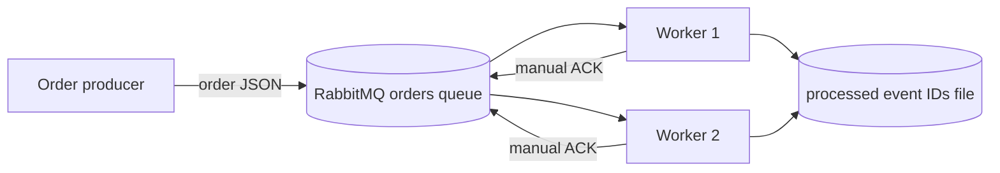
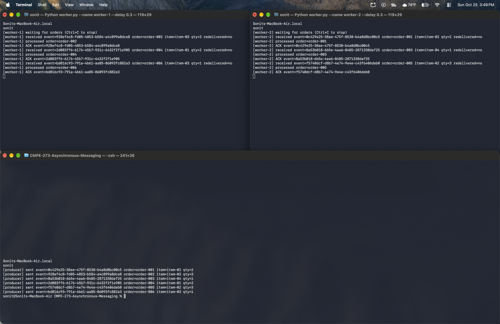
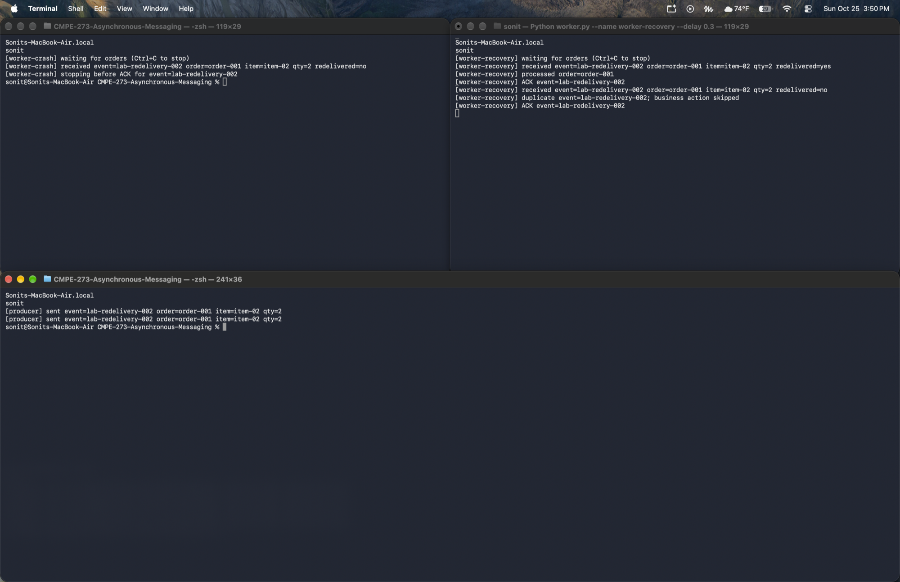

# RabbitMQ Order Queue

A small Python example with one order producer and multiple competing workers. Workers use manual acknowledgements, so RabbitMQ can redeliver an order if a worker disconnects before sending its ACK.

## Architecture



RabbitMQ sends each queued message to one available worker. Both workers share `data/processed_events.txt`, which prevents the same `event_id` from running the business action twice.

## Setup

Python 3.10+ and Docker are required.

```bash
docker-compose up -d

python3 -m venv .venv
source .venv/bin/activate
pip install -r requirements.txt
```

If your Docker installation uses the newer command, replace `docker-compose` with `docker compose`. RabbitMQ listens on port `5672`; its management page is at [http://localhost:15672](http://localhost:15672) with username and password `guest`.

## Run the producer and workers

Open two terminals and start one worker in each:

```bash
# Terminal 1
source .venv/bin/activate
python worker.py --name worker-1
```

```bash
# Terminal 2
source .venv/bin/activate
python worker.py --name worker-2
```

In a third terminal, publish several orders:

```bash
source .venv/bin/activate
python producer.py --count 6
```

The `prefetch_count=1` setting gives idle workers one unacknowledged message at a time. Each worker logs `received`, waits for its simulated work to finish, and then logs `ACK`.

## Successful processing and competing consumers

The screenshot below is from a successful run. For example, `worker-2` receives `order-001`, processes it, and sends its ACK only after processing finishes. The six orders are split between two independent workers, and every event appears in only one worker window.



## Failure and redelivery

Stop the regular workers before this demo. Use a fresh event ID if you have already run it.

```bash
# Terminal 1: this worker exits when the chosen event arrives
python worker.py --name worker-crash --crash-on-event lab-redelivery-002
```

```bash
# Terminal 2: publish after worker-crash is waiting
python producer.py --count 1 --event-id lab-redelivery-002
```

After the first worker stops, start a normal worker. It stays running after it processes the redelivered message.

```bash
# Terminal 3
python worker.py --name worker-recovery
```

RabbitMQ marks the second delivery with `redelivered=yes`.

### Duplicate handling

Publish the same ID once more to test idempotency:

```bash
python producer.py --count 1 --event-id lab-redelivery-002
```

The recovery worker logs `duplicate` and ACKs the message without repeating the business action. The screenshot below captures the original delivery before ACK, the redelivery to another worker, and the duplicate check.



To repeat the demo from an empty local event history:

```bash
rm -f data/processed_events.txt data/processed_events.txt.lock
```

## Tests and cleanup

```bash
python -m unittest discover -v
docker-compose down
```

## Reflection

A message can be delivered more than once when a consumer loses its connection or stops before RabbitMQ receives its ACK. The broker cannot know whether the business action finished, so it safely puts the unacknowledged message back on the queue. Idempotent handling records the event ID and skips an action that has already been claimed. This turns redelivery into a harmless retry instead of a duplicate order operation.
